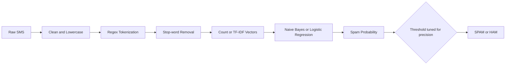
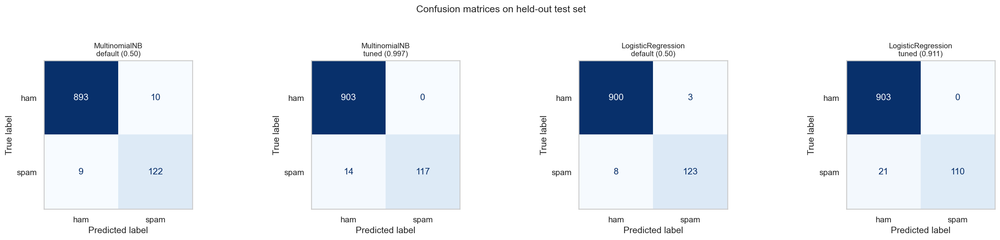
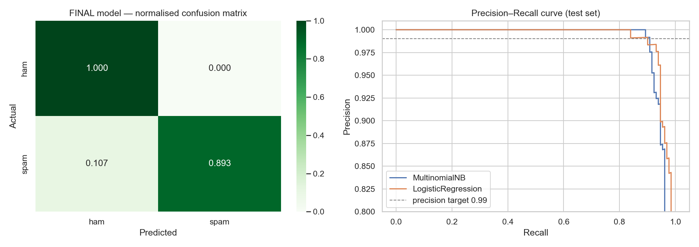

<div align="center">

# 📩 Spam Message Classifier

### **NLP-powered spam detection engineered for _high precision_ — legitimate messages stay in your inbox.**


</div>

---

## 📑 Table of Contents
1. [Objective and Scope](#-objective-and-scope)
2. [Requirements Compliance](#-requirements-compliance)
3. [Pipeline Architecture](#-pipeline-architecture)
4. [Results](#-results)
5. [Acceptance Criteria Verification](#-acceptance-criteria-verification)
6. [Sample Prediction Logs](#-sample-prediction-logs)
7. [How NLP Is Used](#-how-nlp-is-used)
8. [Project Structure](#-project-structure)
9. [Quick Start](#-quick-start)
10. [Limitations and Future Work](#-limitations-and-future-work)

---

## 🎯 Objective and Scope
**Train a text classifier, evaluate it with Precision, Recall and F1-score, and demonstrate sample predictions.**

This project classifies SMS messages as **SPAM** or **HAM (legitimate)** using the **SMS Spam Collection** dataset (5,169 unique messages after de-duplication, **12.6% spam**). Two algorithms are compared, the winner is tuned for **maximum precision**, and an **interactive function** lets anyone test custom messages in real time.

---

## ✅ Requirements Compliance

| # | Requirement | Status | Implementation |
|---|---|:---:|---|
| 1 | **Text preprocessing pipeline** | ✅ | Lowercasing, URL/email/phone/number/currency normalisation, regex **tokenization**, **stop-word removal** (`spam_utils.py`) |
| 2 | **TF-IDF / Count vectorization** | ✅ | **Both** implemented and compared (unigrams + bigrams, `min_df=2`) |
| 3 | **Model comparison** | ✅ | **Multinomial Naive Bayes** vs **Logistic Regression**, 5-fold stratified CV |
| 4 | **Precision, Recall, F1, Confusion Matrix** | ✅ | Full metrics table, classification report, confusion matrices and PR curve |
| 5 | **Interactive prediction function** | ✅ | `predict_message()` and a live `input()` loop for custom messages |
| 6 | **Stack: Python, Scikit-Learn, NLTK/Regex, Pandas, Matplotlib/Seaborn** | ✅ | All used (NLTK stop-words with scikit-learn fallback, Regex tokenizer) |
| 7 | **Saved vectorizer + model pipeline** | ✅ | `artifacts/spam_classifier.joblib` (vectorizer, model and threshold in one file) |
| 8 | **README with metrics table and prediction logs** | ✅ | This document |

---

## 🧩 Pipeline Architecture



| Stage | Detail |
|---|---|
| **Split** | 80 / 20 **stratified** train / test, performed **before** any fitting |
| **Model selection** | 5-fold stratified cross-validation on **training data only** |
| **Precision tuning** | Decision threshold chosen on **out-of-fold training predictions** to reach **≥ 99% precision** |
| **Final evaluation** | **One single pass** on the held-out test set (1,034 messages) |

---

## 📊 Results

### 🏆 Final Model: **Count + MultinomialNB** (threshold = 0.997)

| Precision | Recall | F1-Score | Accuracy | False Positives | False Negatives |
|:---:|:---:|:---:|:---:|:---:|:---:|
| **1.0000** | **0.8931** | **0.9435** | **0.9865** | **0** | **14** |

### Held-out Test Set: Full Comparison
| Model | Vectorizer | Threshold | Accuracy | Precision | Recall | F1 | False Positives | False Negatives |
|---|---|---|---|---|---|---|---|---|
| MultinomialNB | Count | default (0.50) | 0.9816 | 0.9242 | 0.9313 | 0.9278 | 10 | 9 |
| MultinomialNB | Count | tuned (0.997) | 0.9865 | 1.0000 | 0.8931 | 0.9435 | 0 | 14 |
| LogisticRegression | TF-IDF | default (0.50) | 0.9894 | 0.9762 | 0.9389 | 0.9572 | 3 | 8 |
| LogisticRegression | TF-IDF | tuned (0.911) | 0.9797 | 1.0000 | 0.8397 | 0.9129 | 0 | 21 |

> **Reading the table:** the *default (0.50)* rows are standard classifiers; the *tuned* rows apply the precision-optimised threshold. Tuning **eliminates false positives** at the cost of some recall.

### Detailed Classification Report (Final Model)
```
              precision    recall  f1-score   support

         ham     0.9847    1.0000    0.9923       903
        spam     1.0000    0.8931    0.9435       131

    accuracy                         0.9865      1034
   macro avg     0.9924    0.9466    0.9679      1034
weighted avg     0.9867    0.9865    0.9861      1034

```

### Cross-Validation Results (Training Data Only)
| Vectorizer | Model | CV Precision | CV Recall | CV F1 |
|---|---|---|---|---|
| TF-IDF | LogisticRegression | 0.9576 | 0.9386 | 0.9477 |
| Count | LogisticRegression | 0.9698 | 0.9080 | 0.9376 |
| Count | MultinomialNB | 0.9351 | 0.9386 | 0.9368 |
| TF-IDF | MultinomialNB | 0.9615 | 0.9099 | 0.9350 |

### Confusion Matrices


### Final Model: Normalised Confusion Matrix and Precision-Recall Curve


### 🔍 Most Informative Words
| Class | Top indicators |
|---|---|
| 🚨 **SPAM** | `claim`, `prize`, `tone`, `<num> cash`, `<num> prize`, `guaranteed`, `ppm`, `cs`, `awarded`, `ringtone` |
| ✅ **HAM** | `gt`, `lt`, `lt gt`, `lor`, `later`, `really`, `ask`, `cos`, `say`, `lol` |

---

## 🛡️ Acceptance Criteria Verification

| Acceptance Criterion | Result | Evidence |
|---|:---:|---|
| **High precision: minimise false positives** (legit marked as spam) | **PASSED** | Precision = **1.0000** with **0 false positive(s)** out of **903** legitimate test messages |
| **Evaluation strictly on held-out test data, no data leakage** | **PASSED** | Split before fitting; vectorizer inside `Pipeline`; threshold and model chosen via training-only cross-validation; duplicates removed before the split |
| **Interactive function demonstrates real-time inference** | **PASSED** | `predict_message()` returns label and spam probability instantly (see logs below) |

### 🔒 Data-Leakage Controls
- ✔️ **Test set locked away** immediately after the stratified split
- ✔️ **Vectorizer fitted on training folds only** (TF-IDF vocabulary and IDF never see test text)
- ✔️ **Threshold tuned on out-of-fold training predictions**, never on test data
- ✔️ **Final model selected by training CV**, not by test scores
- ✔️ **Exact duplicate messages removed** before splitting

---

## 🧪 Sample Prediction Logs

| Prediction | Spam Probability | Message |
|:---:|:---:|---|
| 🚨 SPAM | 1.000 | Congratulations! You've won a £1000 Walmart gift card. Call 09061701461 now to claim  |
| 🚨 SPAM | 1.000 | URGENT! Your account has been suspended. Click http://bit.ly/secure-login to verify i |
| 🚨 SPAM | 1.000 | Free entry in 2 a weekly competition to win FA Cup final tickets. Text FA to 87121 to |
| 🚨 SPAM | 1.000 | WINNER!! As a valued network customer you have been selected to receive a £900 prize  |
| ✅ HAM | 0.000 | Hey, are we still meeting for lunch tomorrow at 1? |
| ✅ HAM | 0.008 | Can you send me the notes from today's lecture? Thanks! |
| ✅ HAM | 0.000 | Mom said dinner is ready, come home soon |
| ✅ HAM | 0.000 | I'll be late, stuck in traffic. Start without me |
| ✅ HAM | 0.029 | Your OTP for the library portal is 482913. Do not share it with anyone. |
| ✅ HAM | 0.003 | Reminder: project submission deadline is Friday 5 PM |

---

## 🧠 How NLP Is Used

| Step | What happens | Why it matters |
|---|---|---|
| **1. Normalisation** | Lowercase; URLs, phones, numbers and currency become `<url>`, `<phone>`, `<num>`, `<money>` | The *presence* of a phone number or link is a spam signal, not its exact value |
| **2. Tokenization** | Regex splits text into words | Converts raw text into units a model can count |
| **3. Stop-word removal** | Removes words like *the, is, and* | Focuses the model on informative words (*prize, claim, free*) |
| **4. Vectorization** | **Count** or **TF-IDF** (unigrams + bigrams) | Converts text to numbers; TF-IDF up-weights rare, distinctive words |
| **5. Classification** | **Naive Bayes** or **Logistic Regression** | Learns which word patterns separate spam from ham |

---

## 📁 Project Structure
```
spam-classifier/
├── spam_classifier.ipynb        # Full training, evaluation and demo notebook
├── spam_utils.py                # Preprocessing and tokenizer (required to load the model)
├── README.md                    # Project report (this file)
├── sms.tsv                      # Dataset (auto-downloaded)
└── artifacts/
    ├── spam_classifier.joblib   # Saved pipeline: vectorizer + model + threshold
    ├── test_metrics.csv         # Test metrics table
    ├── confusion_matrices.png
    └── final_cm_and_pr_curve.png
```

---

## 🚀 Quick Start

### Option A: Google Colab (zero setup)
1. Open [colab.research.google.com](https://colab.research.google.com) → **File → Upload notebook** → `spam_classifier.ipynb`
2. Click **Runtime → Run all**

### Option B: Local
```bash
pip install pandas scikit-learn nltk matplotlib seaborn joblib tabulate
jupyter notebook spam_classifier.ipynb     # then Run All
```

### Use the saved model
```python
import joblib, spam_utils                  # spam_utils.py must be importable
bundle = joblib.load("artifacts/spam_classifier.joblib")

text = "Congratulations! You won a free prize, call now"
prob = bundle["pipeline"].predict_proba([text])[0, 1]
print("SPAM" if prob >= bundle["threshold"] else "HAM", round(prob, 3))
```

---

## ⚠️ Limitations and Future Work
- **Recall trade-off:** the precision-first threshold lets some spam through (14 of 131 in the test set); lowering the threshold raises recall but risks false positives.
- **Dataset scope:** trained on English SMS from one collection; new spam styles (crypto, OTP phishing, other languages) need fresh data.
- **Future work:** word embeddings / transformer models (e.g. BERT), multilingual support, a deployed API or web app, and periodic retraining.

---

<div align="center">

**Built with Python, scikit-learn, Pandas, Matplotlib and Seaborn**

</div>